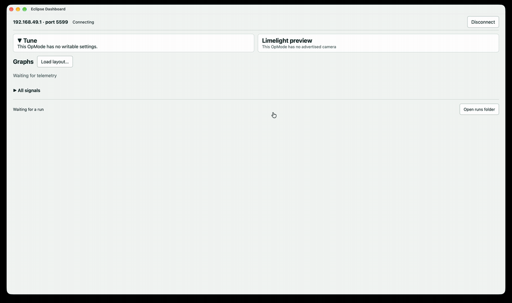

# EclipseDashboard 0.2.2

EclipseDashboard is a lightweight desktop diagnostics app built by FTC Team 30618 Eclipse. Connect to a robot running [DiagServer 0.3.0](https://github.com/Tawasaw/DiagServer) to load its graphs and tuning controls automatically.

## Features
- Live plotting for robot variables and telemetry 
- Live tuning for robot variables
- Logging and data storage for offline data analysis
- Real-time streaming and recording of Limelight camera and metrics
- Live access to Limelight configuration

## Quick start

1. **Install the app.** Under **Assets** on the release page, download and open the installer for your computer. [Download the latest EclipseDashboard release](https://github.com/Tawasaw/EclipseDashboard/releases/latest).

   | Computer | Package |
   | --- | --- |
   | Mac with Apple Silicon or Intel | Universal `.dmg` |
   | Windows x64 | `.exe` installer |
   | Debian or Ubuntu x64 | `.deb` package |

2. **Prepare the robot.** Join the robot’s Wi-Fi on your laptop. On the Driver Station, select a diagnostics-enabled OpMode and press **INIT**. You can also connect after **START**. To capture the start of a run, connect during INIT.
3. **Connect.** Open EclipseDashboard, enter the robot IP address, and click **Connect**. The default is `192.168.43.1` on TCP port `5599`. If your team uses `192.168.49.1`, select that address. The app remembers the last successful connection.

## Using the dashboard

| View | What you can do |
| --- | --- |
| **Graphs** | See the last 15 seconds of telemetry for each graph. Click a title to collapse the graph, drag its handle to reorder it, or click a size icon to resize it. Click a legend entry to hide or restore an individual curve. |
| **All signals** | Search by field name to see its latest value and unit, including fields omitted from graphs. |
| **Tune** | Enter a value within the displayed range and click **Apply**. For example, the BIOBUZZ LED test registers `diag_ledcolor` with a range of 0 to 1. |
| **Camera** | Watch the Limelight preview in the same scrolling workspace as the graphs and tuning controls. |

This recording shows a practice run with the Limelight feed, robot position, and shooter telemetry.



## What the robot needs

The OpMode must start DiagServer and publish telemetry. To enable automatic layout discovery, include the library in `TeamCode/build.gradle` and deploy TeamCode to the robot. [DiagServer setup and examples](https://github.com/Tawasaw/DiagServer)

```gradle
implementation 'com.eclipse30618.ftc:diaglib:0.3.0'
```

- **Graphs** come from the OpMode’s grouped JSON schema in `TeamCode/src/main/assets/configs/`. Use `"graph": false` for fields such as `run_id` that belong in the CSV but do not need a plot.
- **Tuning controls** come from settings registered in Java. Registering `diag_ledcolor` in the LED OpMode is enough for it to appear under **Tune**.

## CSV logs

Logging starts when the laptop receives its first telemetry sample. Click **Open runs folder** to find the CSV in `Documents/EclipseDashboard/Runs/`. Each row includes the laptop arrival time (`host_ts_ms`) and the subscribed robot fields. Open it in a spreadsheet to review the run.

A change in `run_id` starts a new CSV. If the OpMode omits a numeric run ID, the filename uses `session`. A CSV and a video from the same run share a filename prefix, for example:

```text
diag_1793259000_1793259000123_1.csv
diag_1793259000_1793259000123_1.1793259001456.mkv
```

## Limelight preview and recording

1. In the OpMode, start the Limelight tunnels and pass the tunnel manager to `SchemaDiagBus` so the dashboard receives its preview and recording ports.
2. Open **Camera** to see the preview. The app uses the robot IP you connected to. The standard ports are `5800` for preview and `5802` for the raw stream.
3. To save video, install FFmpeg on the laptop and make sure the desktop app can find `ffmpeg` on its `PATH`. Click **Record raw video**. If telemetry has not arrived yet, the app waits for the first CSV to open.
4. When the status shows **Recording**, the app is writing the raw video stream to disk. Click **Stop recording**, then **Open runs folder** to find the Matroska (`.mkv`) clip beside its CSV. If the run ID changes while recording, the app starts a new clip.

## Development and packaging

Install Node.js, Rust, and the Tauri 2 prerequisites for your platform. macOS uses the Xcode command line tools, Windows uses the MSVC build tools and WebView2, and Linux uses WebKitGTK 4.1 and GTK development packages.

```sh
npm ci
npm run dev
```

Run the protocol tests and build a native installer with:

```sh
cargo test --locked --manifest-path src-tauri/Cargo.toml
npm run build
```

Local bundles appear under `src-tauri/target/release/bundle/`. GitHub Actions runs the tests and builds installers on all three platforms for pushes to main, pull requests, and manual runs. [CI workflow](.github/workflows/build.yml)

### Repository layout

```text
web/                        Desktop interface
src-tauri/src/main.rs       Robot connection, CSV logging, and video recording
src-tauri/icons/            App icon source and platform icons
docs/                       Connection screenshot and demo recording
.github/workflows/build.yml Platform tests, builds, and downloadable installers
```
