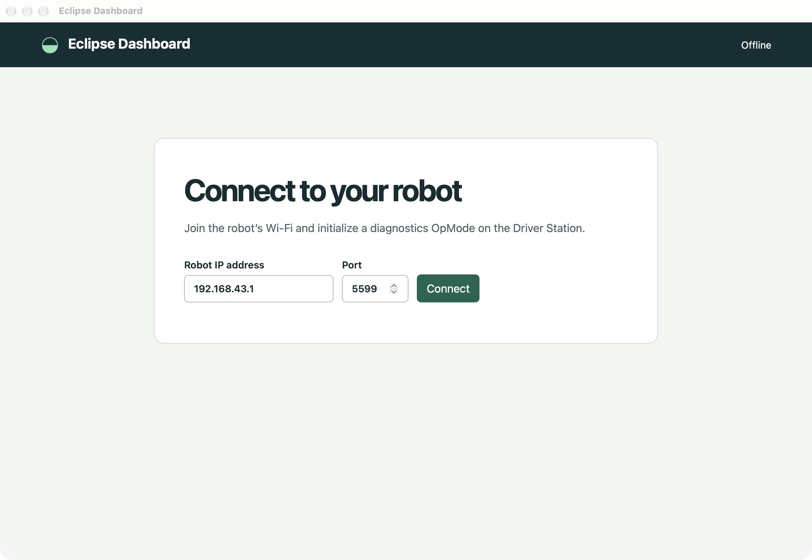

# EclipseDashboard 0.2.0

A desktop telemetry dashboard for FTC students using DiagServer. Join the robot Wi-Fi, initialize a diagnostics OpMode, select the robot address, and press **Connect**. The default is 192.168.43.1 on TCP port 5599. The app remembers the last successful address.

**Graphs** plots the last 15 seconds of telemetry. DiagServer 0.3.0 supplies graph titles, series and controls through HOWDY. Older servers use automatic signal grouping. Use **Load layout** for a team JSON with grouped fields or a graphs/series list. Graphs use the connected robot’s field catalog. **All signals** shows the advertised fields and latest values. **Tune** lists settings registered by the active robot program. Enter a value and press **Apply** to send it.

**Camera** shows the Limelight MJPEG stream on the advertised preview port (legacy default 5800). It can also be displayed beside a graph. Initialize an OpMode that starts the Limelight tunnels. Raw recording uses the advertised raw port (legacy default 5802) and requires FFmpeg on the desktop app’s PATH. CSVs are automatic. Each run produces a new timestamped CSV in Documents/EclipseDashboard/Runs. Raw clips share its filename prefix. **Open runs folder** opens that directory.

## Development and packaging

Install Rust, Node.js, and the Tauri 2 platform build prerequisites (Xcode command line tools on macOS, MSVC build tools and WebView2 on Windows, WebKitGTK 4.1 and GTK development packages on Linux).

    npm ci
    npm run dev

Build on the intended operating system with `npm run build`. Native bundles appear under `src-tauri/target/release/bundle`. A packaged app needs no Node.js, Python, or Pixi installation. Camera recording additionally requires FFmpeg. The Rust protocol test runs with `cargo test --manifest-path src-tauri/Cargo.toml`.

## Download a CI build

Open a successful [desktop build](https://github.com/Tawasaw/EclipseDashboard/actions/workflows/build.yml) and download the artifact for your computer. Unzip it to get a universal macOS DMG (Apple Silicon and Intel), a Windows x64 installer, or a Debian/Ubuntu x64 package. CI runs the protocol tests and builds the installers on pushes to main, pull requests, and manual runs.
